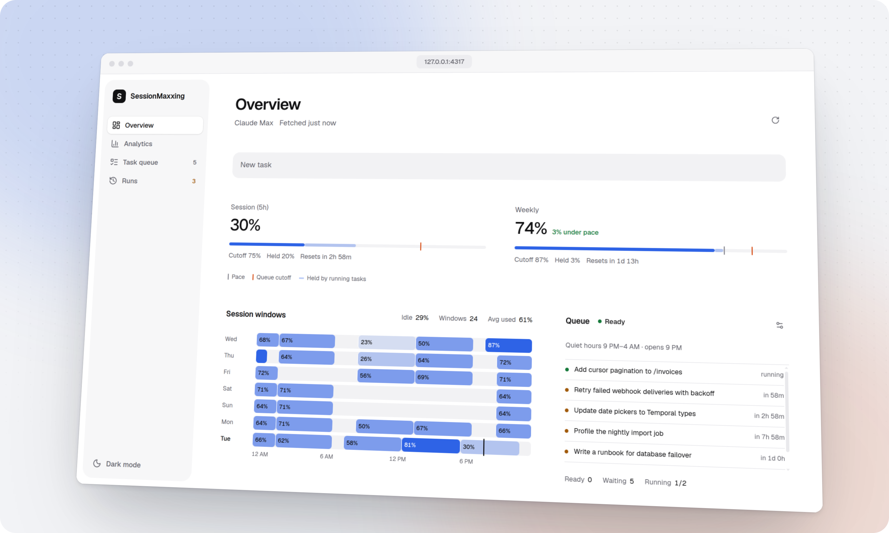
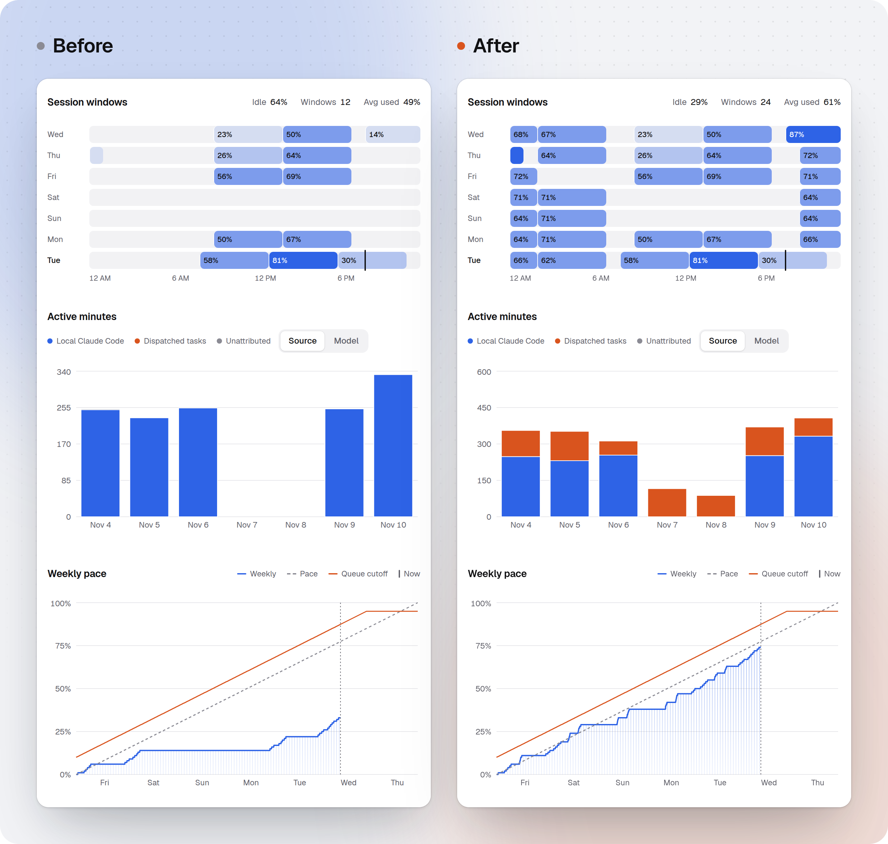
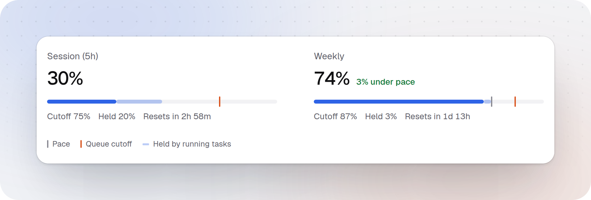
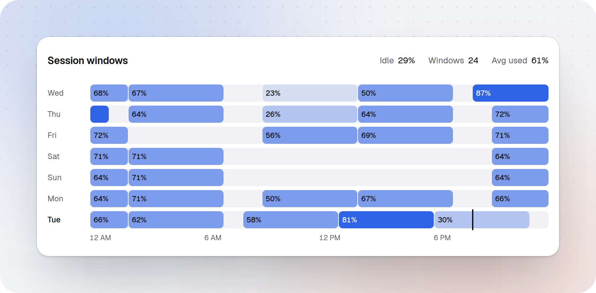
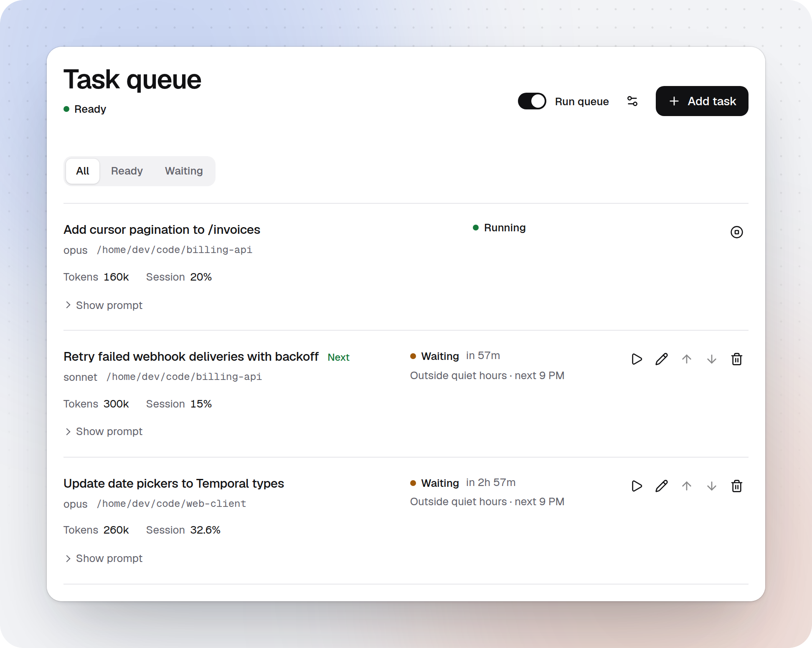
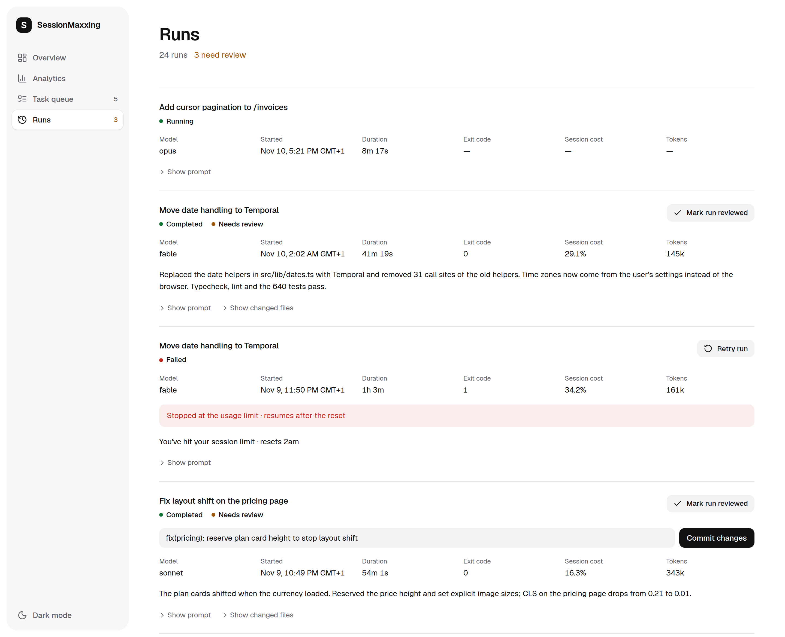

# SessionMaxxing

Queue Claude Code tasks and walk away: they run in the session windows you would otherwise waste, overnight or while you're out, so you don't have to sit at your screen all day.

<picture>
  <source media="(prefers-color-scheme: dark)" srcset="docs/screenshots/hero-dark.png">
  
</picture>

## Before and after

The same week of daytime work, without the queue and with it. Queued runs fill the nights and the weekend, and weekly usage keeps pace.

<picture>
  <source media="(prefers-color-scheme: dark)" srcset="docs/screenshots/before-after-dark.png">
  
</picture>

## What it does

### Usage against pace

Session and weekly usage from the same source as Claude Code's `/usage`, with the pace mark and the cutoff where the queue stops.

<picture>
  <source media="(prefers-color-scheme: dark)" srcset="docs/screenshots/usage-dark.png">
  
</picture>

### Every window of the week

Each five-hour session window of the last seven days and how much of it you used.

<picture>
  <source media="(prefers-color-scheme: dark)" srcset="docs/screenshots/windows-dark.png">
  
</picture>

### A queue that waits for quiet hours

Tasks start in the hours you rarely use Claude Code, ranked from your own history, and only while the session and the week have room.

<picture>
  <source media="(prefers-color-scheme: dark)" srcset="docs/screenshots/queue-dark.png">
  
</picture>

### Review when you're back

Each finished run shows its summary, session cost and changed files, ready to commit or mark reviewed.

<picture>
  <source media="(prefers-color-scheme: dark)" srcset="docs/screenshots/runs-dark.png">
  
</picture>

## Install

Needs Linux and Claude Code, installed and signed in. Works with any Claude plan.

With npm and Node.js 22.12 or newer:

```sh
npm install --global sessionmaxxing
sessionmaxxing
```

Then open http://127.0.0.1:4317.

With Docker Compose, in a clone of this repository:

```sh
cp .env.example .env    # then fill in the fields
docker compose up -d --build
```

To queue from inside Claude Code, copy the [queue-task skill](skills/queue-task/SKILL.md) into `~/.claude/skills/` and ask Claude to "queue this".

## Security

The dashboard has no login. Every task runs as `claude --dangerously-skip-permissions`, so anyone who can reach the dashboard can run commands as you. Keep it on `127.0.0.1` or a private network. The Docker setup also mounts `/var/run/docker.sock`, which gives any queued prompt root on the host.

## License

Apache-2.0. See [LICENSE](LICENSE).
