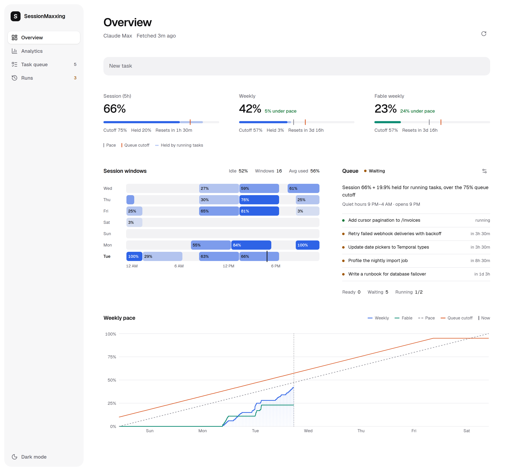
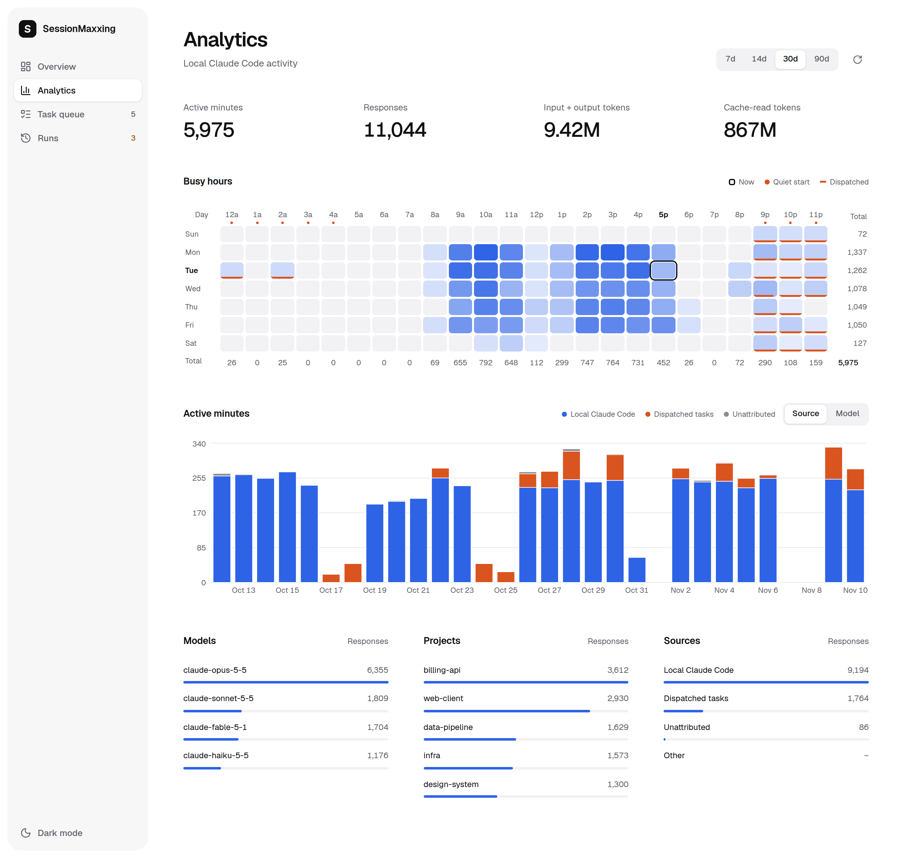

# SessionMaxxing

SessionMaxxing is a local dashboard that runs queued Claude Code tasks in the five-hour session windows you would otherwise leave unused, while keeping your weekly limit on pace. It reads the same usage numbers as Claude Code's `/usage` panel and works with any Claude plan, including Pro, Max, Team and Enterprise.

<picture>
  <source media="(prefers-color-scheme: dark)" srcset="docs/screenshots/overview-dark.png">
  
</picture>

## How it works

Every five minutes the server asks Anthropic for your plan's usage, using the login Claude Code already keeps, and stores 90 days of samples. You add tasks to a queue, each with a prompt, a work directory, a model and the tokens the run is expected to use. When the current session window has room for a task and weekly usage is on pace, the server starts it as a headless `claude -p` run in its work directory. By default tasks start only in the hours you rarely use Claude Code, ranked from your own transcripts, so the windows you work in stay free for you. Finished runs appear on the Runs page for review.

## Requirements

- Linux. The server reads Claude Code's login from `~/.claude/.credentials.json`, where Claude Code keeps it on Linux. On macOS Claude Code stores it in the Keychain, which the dashboard does not read.
- Claude Code, installed and signed in.
- Node.js 22.12 or newer for a native install, or Docker with the Compose plugin.

## Install

### npm

```sh
npm install --global sessionmaxxing
sessionmaxxing
```

The server listens on http://127.0.0.1:4317. The package also installs `sessionmaxxing-queue`, which adds tasks from a terminal.

### From source

In a clone of this repository:

```sh
pnpm install
pnpm build
pnpm start
```

### Docker Compose

In a clone of this repository:

```sh
cp .env.example .env
docker compose up -d --build
```

Fill in `.env` before the last command. Compose refuses to start while a required field is empty.

| Field | Value |
| --- | --- |
| `SESSIONMAXXING_UID`, `SESSIONMAXXING_GID` | Output of `id -u` and `id -g` |
| `SESSIONMAXXING_DOCKER_GID` | Output of `stat -c %g /var/run/docker.sock` |
| `SESSIONMAXXING_HOME` | Your home directory |
| `SESSIONMAXXING_BIND_ADDRESS` | Address the port is published on; `127.0.0.1` keeps the dashboard on this machine |
| `SESSIONMAXXING_PORT` | Published port, usually `4317` |
| `SESSIONMAXXING_EDITION` | `full` or `lite` |
| `TZ` | IANA time zone, such as `Europe/Berlin` |
| `SESSIONMAXXING_ALLOWED_HOSTS` | Extra host names or addresses you open the dashboard by; may stay empty |

The image includes Claude Code and the Docker CLI with the Compose and Buildx plugins. Compose mounts your home directory at the same path, so the container works with your Claude Code login and history, your work directories, and the same data directory a native install uses. A lock file keeps a second server off that directory.

## Queue tasks

<picture>
  <source media="(prefers-color-scheme: dark)" srcset="docs/screenshots/queue-dark.png">
  
</picture>

Add a task with **Add task** on the Task queue page, or type a prompt into **New task** on the Overview. A task needs a title, the prompt, a work directory under your home directory and a model: Fable 5.1, Opus, Sonnet 5.5 (the default) or Haiku. **Tokens** is the number of tokens the whole run is expected to use, subagents included. Leave it on **Auto** and Haiku estimates it from the prompt and your past runs. Optional fields set a priority, the maximum number of turns, an earliest start, a preferred five-hour window, the tasks it depends on and the restart method of its work directory.

Token counts are weighted by list price: an output token counts once, and input, cache-write and cache-read tokens count at their price relative to output. The server converts tokens to session percent with a rate per model family, fitted from the last 14 days of your own five-hour windows. A task stores tokens, so its expected session cost follows your current rates when your plan or the task's model changes.

## When a task starts

With **Run queue** on, a task starts once every check below passes. The queue shows which check a waiting task fails and when it is expected to start.

1. A run slot is free. **Tasks running at once** defaults to 2 and goes up to 4.
2. The usage snapshot is under 15 minutes old and was fetched after the last run ended.
3. Session usage, plus the expected cost of the tasks already running, plus this task's own expected cost, is at or below the queue cutoff of 100% minus **Session kept for you in quiet hours** (default 25%). A task's expected cost is its tokens at the fitted rate until a run of it completes, then the most a completed run of it has cost.
4. Weekly usage, plus **Weekly held per running Claude task** (default 3 points) for each running task, is at or below pace plus **Weekly margin above pace** (default 10%), and never above 95%. Pace is the share of the seven-day window that has passed. Fable tasks also check the Fable weekly limit when your plan reports one.
5. The current hour is one of the **Quiet start hours per day** (default 8): the local start hours whose next five hours held the least of your own Claude Code activity over the last 30 days. A task with a preferred window waits for its window instead, and no task starts before its earliest start.
6. Every task it depends on has completed, and no running task works in the same directory, a directory nested in it, or the same git repository, worktrees included.

Setting **Session kept for you outside quiet hours** below its default of 100% lifts check 5. Tasks then start at any hour, and outside quiet hours the cutoff becomes 100% minus that value.

**Run task**, the play button on a queued task, starts it at once and skips checks 2 to 5. It refuses to start while check 1 or 6 fails or a restart is pending.

When Claude Code stops a run at the session or weekly limit, the task goes back to the queue and its next run resumes the same Claude session. `claude -p` exits when the lead agent's turn ends, so every launched prompt ends with an instruction to keep subagents and long commands in the foreground, and a run that exits while a subagent is still working is marked failed. Tasks still running when the server stops are marked failed at the next start.

## Review runs

<picture>
  <source media="(prefers-color-scheme: dark)" srcset="docs/screenshots/runs-dark.png">
  
</picture>

The Runs page lists each run with its model, start time, duration, exit code, session cost and tokens, followed by the run's final message. A run needs review when it left uncommitted changes or commits on a branch other than `main` or `master`. **Show changed files** lists what it touched. For uncommitted changes, Haiku suggests a conventional commit subject from the run's title, final message and file list; edit it if needed and press **Commit changes**, which commits only those files. **Mark run reviewed** clears a run without committing, and **Retry run** puts a failed or cancelled task back in the queue.

## Analytics

<picture>
  <source media="(prefers-color-scheme: dark)" srcset="docs/screenshots/analytics-dark.png">
  
</picture>

Analytics reads Claude Code's local transcripts and prompt history for the last 7, 14, 30 or 90 days. The page totals active minutes, responses and tokens, maps busy hours with the quiet start hours marked, charts daily active minutes by source or model, and breaks responses down by model, project and source. **Dispatched tasks** are runs the queue started, matched by session id. **Local Claude Code** is your interactive sessions, and **Unattributed** covers headless sessions the dashboard did not start. Usage from claude.ai or other machines shows up only in the official meters.

## Queue from a terminal

```sh
sessionmaxxing-queue --title "Retry failed webhook deliveries" \
  --prompt-file ./prompt.md --workdir ~/code/billing-api --model opus
```

In a source checkout the same helper is `node scripts/queue-task.mjs`. Before posting, it prints session and weekly usage, the quiet start hours and whether the queue would start the task now. Other flags are `--prompt`, `--priority`, `--window HH`, `--tokens N|auto`, `--depends-on ID[,ID]`, `--after ISO`, `--max-turns N`, `--url URL` and `--dry-run`. `--help` prints the full usage.

`skills/queue-task` is a Claude Code skill that queues work through this helper when you ask Claude to queue something or run it later. Copy the folder to `~/.claude/skills/` to install it.

## Keep session active

A five-hour window opens with your first message after the previous one ended. **Keep session active** in Queue settings opens the next window as soon as the previous one ends, by running a one-turn `claude -p hi` on Haiku from your home directory, so windows run back to back. It works whether the queue is on or off, and it skips while a task is running or the weekly limit is at 100%.

## Apply and restart

With **Apply and restart without review** on (Queue settings, off by default), every run is told to edit its work directory in place and leave git alone, so its changes are live when it finishes. The instruction names the directory's restart method, so the agent leaves that step to the dashboard and runs any other deploy the project needs itself. After a run that completed with changes, the server runs the restart method of its work directory. The method is set in the task form's **Restart** field and shared by every task in that directory.

| Method | What runs |
| --- | --- |
| None | Nothing |
| Docker Compose | `docker compose build`, then `docker compose up -d`, in the work directory |
| Command | One argument per line, run in the work directory without a shell |

The run card shows **Restart queued**, **Restarting**, **Restarted** or **Restart failed**, with the output of a failed restart. No task starts while a restart is pending. Restarts run one at a time, and a step that runs longer than 30 minutes is stopped and fails the restart. In the Docker install, when the work directory is the dashboard's own Compose project, the restart runs from a short-lived sibling container, so the dashboard can rebuild and recreate itself.

## Lite edition

`SESSIONMAXXING_EDITION=lite` serves only the Task queue and Runs pages, with session and weekly usage at the top of the queue. It leaves out analytics, token estimates, rate fitting and quiet hours. A lite task starts when a slot is free, the snapshot is fresh, session usage plus **Session held per running Claude task** (default 10 points) for each running task is at or below 100% minus **Session kept for you** (default 25%), and weekly usage passes the same pace check as in the full edition. Dependencies, repository locks, **Run task**, restart methods and **Keep session active** work as in the full edition.

A full start refuses a data directory that holds lite tasks. A lite start reads full data and ignores the token counts.

## Configuration

| Variable | Default | Meaning |
| --- | --- | --- |
| `SESSIONMAXXING_HOST` | `127.0.0.1` | Bind address, an IPv4 or IPv6 literal. A wider bind such as `0.0.0.0` also needs `SESSIONMAXXING_ALLOWED_HOSTS` |
| `SESSIONMAXXING_PORT` | `4317` | Listen port |
| `SESSIONMAXXING_ALLOWED_HOSTS` | empty | Comma-separated host names or addresses accepted besides `localhost`, `127.0.0.1` and the bind address. No ports, paths or wildcards |
| `SESSIONMAXXING_DATA_DIR` | see [Data](#data) | Absolute path of the data directory |
| `SESSIONMAXXING_WORKDIR_ROOT` | your home directory | Directory every task work directory must sit under |
| `SESSIONMAXXING_EDITION` | `full` | `full` or `lite`; any other value stops startup |
| `TZ` | the system zone | IANA time zone for day boundaries, quiet hours and every chart |
| `SESSIONMAXXING_URL` | `http://127.0.0.1:4317` | Server the queue helper talks to |
| `SESSIONMAXXING_PATH_MAP` | empty | `from=to[,from=to]` path prefixes the queue helper rewrites `--workdir` through, for a server that sees your folders under other paths |

Queue settings are edited in the dashboard and saved to `dispatch-settings.json`.

## Data

All state lives in one directory, created with mode 0700: `SESSIONMAXXING_DATA_DIR` when set, else `$XDG_DATA_HOME/sessionmaxxing`, else `~/.local/share/sessionmaxxing`. It holds the queue, settings, usage samples, run records and restart records as JSON files, plus a lock file that keeps a second server off the directory. The server refuses to start on a corrupt file and leaves the file as it is.

## Privacy and security

The server calls two Anthropic endpoints: `api.anthropic.com/api/oauth/usage` for usage, and `platform.claude.com/v1/oauth/token` to refresh Claude Code's access token when it is about to expire. A refresh writes the new token to `~/.claude/.credentials.json`, the file Claude Code reads. No dashboard route returns the token, and the server makes no other network requests. The Claude Code processes it launches talk to Anthropic as usual.

Transcript content stays on the server. The browser receives task prompts, work directories, each run's final message and changed files, and the output of a failed restart. Analytics carry only aggregates.

The dashboard has no login. Anyone who can reach it can queue a prompt, and every task runs as `claude --dangerously-skip-permissions`, so reaching the dashboard means running commands as you. Keep it on `127.0.0.1` or a private network. The server rejects requests addressed to a host name it does not allow, and requests whose `Origin` does not match the host.

The Docker setup mounts `/var/run/docker.sock` so restart methods can run `docker compose`. Access to that socket is root on the host, so any dispatched prompt can gain root as well.

## API

The UI talks to a JSON API on the same port.

| Route | Purpose |
| --- | --- |
| `GET /api/usage`, `POST /api/usage/refresh` | Latest snapshot, samples and session windows; fetch now |
| `GET /api/queue`, `PUT /api/queue/auto`, `PUT /api/queue/order` | Tasks with their gate status; the queue switch; task order |
| `POST /api/tasks`, `PATCH /api/tasks/:id`, `DELETE /api/tasks/:id` | Add, edit or delete a task |
| `POST /api/tasks/:id/run`, `/cancel`, `/retry` | Run now, cancel or retry a task |
| `GET /api/runs`, `GET /api/runs/pending-review` | Runs; runs that need review |
| `POST /api/runs/:id/commit-message`, `/commit`, `/reviewed` | Suggest a commit subject, commit, mark reviewed |
| `GET /api/dispatch-settings`, `PUT /api/dispatch-settings` | Queue settings and the current gate status |
| `GET /api/restart-methods?workdir=`, `PUT /api/restart-methods` | A work directory's restart method |
| `GET /api/environment` | Time zone, work-directory root and edition |
| `GET /api/workdirs` | Recent Claude Code project directories |
| `GET /api/analytics?days=30`, `GET /api/plan-score` | Local activity and plan score, full edition only |

## Development

Run `pnpm dev` for the API server and `pnpm dev:ui` for the Next.js dev server in two terminals. Before a commit, run:

```sh
pnpm typecheck
pnpm lint
pnpm test
pnpm build
```

Tests use synthetic transcripts, fake Claude processes and a stubbed usage fetcher. They never call Anthropic or start Claude Code.

## License

Apache-2.0. See [LICENSE](LICENSE).
